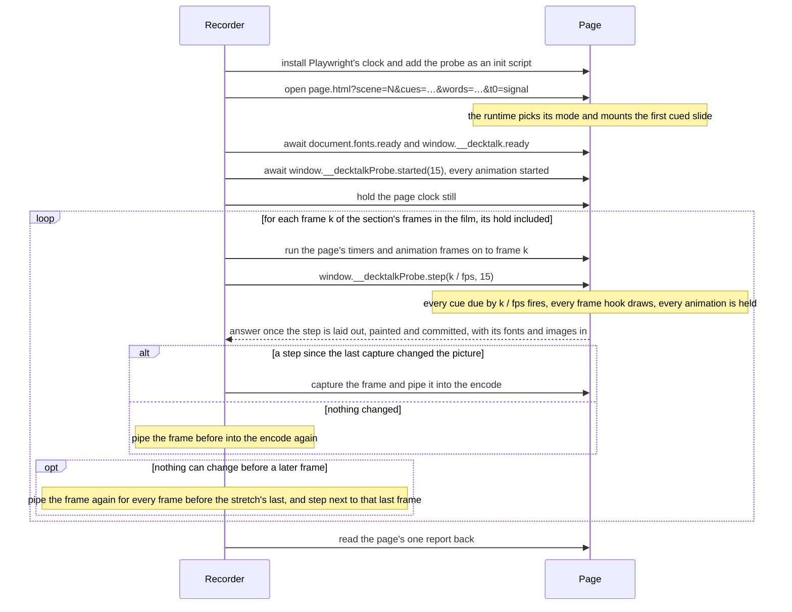

The page contract is the whole vocabulary a deck page may write. An element on a slide has four
moments, and each of them is a cue name. An element that travels for longer than a moment declares
a motion instead, which names two cues. Everything else is either how a moment or a motion looks,
which is a closed word the contract owns, or what it means, which is a sentence for the
transcript. The second a thing happens is never written on the page, because `cues.json` owns it.

1. `decktalk-runtime.js` implements the contract. DeckTalk serves it at
   `/__decktalk/decktalk-runtime.js` on the origin it opens the page at, and a page that would rather
   [follow it by hand](/guides/page-by-hand) can.
2. A scene is markup: a `[data-scene]` wrapper holding one `<template data-slide>` per slide.
   Attributes do the work, so a page needs no JavaScript of its own.
3. The runtime adds only the stage element, the slide transitions and the reveal effects. Every rule
   of its own sits inside `:where()`, so one rule of yours wins.
4. To write your first page, follow [Your first deck](/guides/first-deck).

## The four moments

An element declares up to four moments, and each attribute's value is a cue name rather
than a number.

| Moment | What happens | How long it plays |
|---|---|---|
| `data-in` | The element arrives. | The entrance `data-in-style` names, or the length `data-in-seconds` gives it. |
| `data-back` | The element steps back, dimmed to 45 percent and still readable. | 0.28 seconds. |
| `data-front` | The element returns to full strength. | 0.2 seconds. |
| `data-out` | The element leaves. | The exit `data-out-style` names, which is 0.2 seconds either way. |

They play in that order: in, back, front, out. An exit declared at or before its own entrance never
plays, which is [`PAGE_MOMENT_ORDER`](/reference/findings/PAGE_MOMENT_ORDER), and the order is read
off the cues the slide declares rather than guessed.

`data-back` and `data-front` are attention rather than reveal. Use them when one thing on the slide
has to recede while another is read, so the page never has to remove something and bring it back.

## The cue id

Each moment names a cue, and the runtime qualifies that name with its slide into the
[cue id](/concepts/cues#the-cue-id) `cues.json` carries. Here it is `4.1:expand`.

```html deck/index.html
<div data-scene="4" data-name="The listing">
  <template data-slide="4.1" data-describe="how often value is still listed">
    <p data-in="expand" data-describe="the hourly figure">by hour, through first pitch</p>
  </template>
</div>
```

That split is the contract's whole shape. The page owns what a thing looks like and what it means,
and `cues.json` owns the second it happens on. An author writing a slide never types a number of
seconds, and an author writing `cues.json` never types a class or an effect.

## The subjects

Every attribute is written on one of four subjects, and the table below names the subjects each row
admits.

| Subject | What it is |
|---|---|
| element | Anything inside a slide that declares a moment, a description or an effect. |
| container | An element whose children are the thing that arrives, which is what `data-stagger` and `data-spotlight` are written on. |
| scene | The `[data-scene]` wrapper a section names, which holds the slides. |
| slide | One `<template data-slide>` of a scene, which is what mounts. |

## Every attribute

This is the whole contract. `Value` gives the closed word set where a row has one, and otherwise says
what kind of value the row takes. A row that publishes a default may be written bare to take it, so
`data-words` alone is `data-words="highlight"`. `Range` is the range the row admits, in seconds, and
a value outside it or off its step earns [`PAGE_BAD_VALUE`](/reference/findings/PAGE_BAD_VALUE).
`Span` is the seconds of motion the row puts between its own cue and the next one, where `0` is a row
that never moves a pixel and `from the page` is a span read off the page or off a closed word set.

| Attribute | Subject | Value | Default | Range | Span | Code | Meaning |
|---|---|---|---|---|---|---|---|
| `data-in` | element, container | a local cue name |  |  | from the page | [`PAGE_MOMENT_UNKNOWN`](/reference/findings/PAGE_MOMENT_UNKNOWN) | The element arrives at this cue. |
| `data-describe` | element, slide | a description |  |  | 0 | none | The subject of the reveal, which the runtime gives a verb per moment. An empty description means decorative. |
| `data-tex` | element | TeX source |  |  | 0 | [`PAGE_KATEX_ERROR`](/reference/findings/PAGE_KATEX_ERROR) | Typeset with KaTeX, with the element's own text as the readable fallback. |
| `data-tex-display` | element | written bare |  |  | 0 | [`PAGE_KATEX_ERROR`](/reference/findings/PAGE_KATEX_ERROR) | Typeset the TeX as a display equation on its own line rather than inline. |
| `data-in-style` | element, container | `rise`, `settle`, `fade`, `pop`, `draw`, `cut` | `rise` |  | from the page | [`PAGE_BAD_VALUE`](/reference/findings/PAGE_BAD_VALUE) | How the element arrives. Each word declares its own span. |
| `data-back` | element, container | a local cue name |  |  | 0.28 | [`PAGE_MOMENT_UNKNOWN`](/reference/findings/PAGE_MOMENT_UNKNOWN) | The element steps back at this cue, dimmed but still readable. |
| `data-front` | element, container | a local cue name |  |  | 0.2 | [`PAGE_MOMENT_UNKNOWN`](/reference/findings/PAGE_MOMENT_UNKNOWN) | The element returns to full strength at this cue. |
| `data-out` | element, container | a local cue name |  |  | from the page | [`PAGE_MOMENT_ORDER`](/reference/findings/PAGE_MOMENT_ORDER) | The element leaves at this cue. |
| `data-words` | element | `highlight`, `appear` | `highlight` |  | 0.12 | [`PAGE_WORDS_NOT_FOUND`](/reference/findings/PAGE_WORDS_NOT_FOUND) | The line is shown word by word on the voice, matched against the section's spoken words. |
| `data-count` | element | `last`, `first` |  |  | 0.44 | [`PAGE_BAD_VALUE`](/reference/findings/PAGE_BAD_VALUE) | A number in the text counts up from zero when the element arrives. |
| `data-class` | element, container | cue:class pairs |  |  | from the page | [`PAGE_CLASS_UNDESCRIBED`](/reference/findings/PAGE_CLASS_UNDESCRIBED) | Adds a class at a cue, written as cue:class pairs, for the page's own stylesheet. |
| `data-describe-class` | element, container | cue:description pairs |  |  | 0 | none | What each class change means, as cue:description pairs separated by a vertical bar. |
| `data-stagger` | container | seconds |  | 0.04 to 0.2 in steps of 0.04 | from the page | [`PAGE_STAGGER_OVERRUN`](/reference/findings/PAGE_STAGGER_OVERRUN) | The container's children arrive this far apart from one cue. |
| `data-spotlight` | container | written bare |  |  | from the page | [`PAGE_SPOTLIGHT_EMPTY`](/reference/findings/PAGE_SPOTLIGHT_EMPTY) | Each cued child comes to the front as it arrives and the ones before it step back. |
| `data-in-seconds` | element, container | seconds |  | 0.12 to 0.44 in steps of 0.04 | from the page | [`PAGE_BAD_VALUE`](/reference/findings/PAGE_BAD_VALUE) | How long the entrance plays, which governs the entrance alone and never the onset. |
| `data-out-style` | element, container | `fade`, `fall` | `fade` |  | 0.2 | [`PAGE_BAD_VALUE`](/reference/findings/PAGE_BAD_VALUE) | How the element leaves. |
| `data-swaps` | element | written bare |  |  | from the page | [`PAGE_SWAP_AMBIGUOUS`](/reference/findings/PAGE_SWAP_AMBIGUOUS) | The element takes the place of whatever leaves on its own arrival cue, in a held swap. |
| `data-describe-out` | element | a description |  |  | 0 | none | Overrides the departure sentence when leaving means something of its own. |
| `data-motion` | element | an `@keyframes` name |  |  | 0 | [`PAGE_MOTION_UNDECLARED`](/reference/findings/PAGE_MOTION_UNDECLARED) | The element moves through these `@keyframes` from one cue to another, masked from every reveal check and landing on its cues. |
| `data-motion-from` | element | a local cue name |  |  | 0 | [`PAGE_MOTION_CUE_UNKNOWN`](/reference/findings/PAGE_MOTION_CUE_UNKNOWN) | The motion departs at this cue. |
| `data-motion-to` | element | a local cue name |  |  | 0 | [`PAGE_MOTION_CUE_UNKNOWN`](/reference/findings/PAGE_MOTION_CUE_UNKNOWN) | The motion arrives at this cue, so its length is the two cues' seconds apart. |
| `data-motion-ease` | element | `firm`, `glide`, `settle`, `spring` | `firm` |  | 0 | [`PAGE_BAD_VALUE`](/reference/findings/PAGE_BAD_VALUE) | How the motion moves. Settle and spring ease to rest, so their arrival cue must opt out of verify. |
| `data-loop` | element | an `@keyframes` name |  |  | 0 | [`PAGE_MOTION_UNDECLARED`](/reference/findings/PAGE_MOTION_UNDECLARED) | The element turns through these `@keyframes` for as long as its slide is on screen, masked and never a landing. |
| `data-loop-seconds` | element | seconds | `1` | 0.2 to 60 in steps of 0.04 | 0 | [`PAGE_BAD_VALUE`](/reference/findings/PAGE_BAD_VALUE) | How long one turn of the loop takes. |
| `data-clip` | element | a project path |  |  | 0 | [`PAGE_CLIP_UNREADABLE`](/reference/findings/PAGE_CLIP_UNREADABLE) | The element is a pane that plays this project file, a clip with its own sound, drawn under the page and masked from every reveal check. |
| `data-clip-from` | element | a local cue name |  |  | 0 | [`PAGE_MOTION_CUE_UNKNOWN`](/reference/findings/PAGE_MOTION_CUE_UNKNOWN) | The pane clip starts playing, picture and sound, at this cue, and shows its first frame before it. |
| `data-scene` | scene | an id |  |  | 0 | [`PAGE_SCENE_EMPTY`](/reference/findings/PAGE_SCENE_EMPTY) | Declares the scene a section names, on the wrapper that holds its slides. |
| `data-name` | scene | a description |  |  | 0 | none | The scene's name in the index and in the catalog. |
| `data-slide` | slide | an id |  |  | 0 | [`PAGE_SLIDE_NO_ID`](/reference/findings/PAGE_SLIDE_NO_ID) | Declares a slide on a template. Its id qualifies every moment written inside it. |
| `data-preview-seconds` | slide | seconds | `8` | 1 to 60 in steps of 1 | 0 | none | How long the preview rests on this slide. No recording reads it. |
| `data-owns` | slide | cue names |  |  | 0 | [`PAGE_CUE_UNKNOWN`](/reference/findings/PAGE_CUE_UNKNOWN) | Cue names only a handler serves, which no moment attribute mentions. |
| `data-enter` | slide | `crossfade`, `cut` | `crossfade` |  | 0.24 | [`PAGE_BAD_VALUE`](/reference/findings/PAGE_BAD_VALUE) | How this slide replaces the one before it. |

A `data-` attribute that is not in this table is
[`PAGE_ATTR_UNKNOWN`](/reference/findings/PAGE_ATTR_UNKNOWN), reported before a single pixel is
drawn, so a misspelling is a finding rather than an attribute nothing reads.

`decktalk schema page` prints this same table as JSON, with each row's `on`, `kind`, `values`,
`default`, `range`, `code`, `span`, `affects` and `summary`, and beside it the entrance, exit, word,
count, attention and slide word sets with their lengths, `measurable_span_seconds` and `slowest_fps`.
The table above and the schema are written from one registry, so the page cannot say something the
registry does not.

```console
decktalk schema page
```

## The five rows that earn no code

An attribute lives in the contract only when its value can change a judgement or be named by a
finding. Five rows can do neither, because each of them carries text a person wrote or a preview
length nothing records, and each publishes the sentence that says why.

| Attribute | Why no value of it can change a judgement |
|---|---|
| `data-describe` | Any description clears the finding that asks for one, so the description itself is never measured. |
| `data-describe-class` | The transcript prints the description exactly as it was written. |
| `data-describe-out` | It replaces one transcript sentence with another, and neither is measured. |
| `data-preview-seconds` | The preview alone reads it, and a preview is never recorded. |
| `data-name` | It names a scene in the index, which no check and no finding reads. |

The list is closed and a test counts it. An open field saying what a row affects would let every
label back into a contract that exists to hold the things a measurement depends on.

## How long a moment may move

`MEASURABLE_SPAN_SECONDS` is 0.5 seconds, and it is the one ceiling above which a cue cannot be
measured. An effect still playing half a second after its cue covers the frames the next cue is read
from, so it marks its own cue unmeasurable. No span a page can declare may reach it.

| Word set | Lengths |
|---|---|
| Entrances, `data-in-style` | `rise` 0.32, `settle` 0.28, `fade` 0.24, `pop` 0.2, `draw` 0.44, `cut` 0 |
| Exits, `data-out-style` | `fade` 0.2, `fall` 0.2 |
| Slide entrances, `data-enter` | `crossfade` 0.24, `cut` 0 |
| Word styles, `data-words` | `highlight` 0.12, `appear` 0.12 |
| Counts, `data-count` | `last` 0.44, `first` 0.44 |
| Attention, `data-back` and `data-front` | `back` 0.28, `front` 0.2 |

`data-in-seconds` runs from 0.12 to 0.44 in steps of 0.04, which is three to eleven frames at 25
frames a second, the slowest rate a film is recorded at. `data-stagger` runs from 0.04 to 0.2 in the same steps,
which is one to five frames.

A staggered container's total is exact arithmetic, and that is why its overrun is an error.
The last child starts one step per earlier child after the cue, and then plays its own entrance.

```text
total = data-stagger * (children - 1) + the entrance
```

A container with six children at `data-stagger="0.08"` and the default `rise` entrance totals
`0.08 * 5 + 0.32`, which is 0.72 seconds. That is over the ceiling, so it earns
[`PAGE_STAGGER_OVERRUN`](/reference/findings/PAGE_STAGGER_OVERRUN). Four children at the same step
total 0.56 seconds and still overrun. Four children at `0.04` with a `pop` entrance total 0.32
seconds and are fine. A container that staggers no children at all earns
[`PAGE_STAGGER_EMPTY`](/reference/findings/PAGE_STAGGER_EMPTY), and a `data-spotlight` container with no
child that declares `data-in` earns [`PAGE_SPOTLIGHT_EMPTY`](/reference/findings/PAGE_SPOTLIGHT_EMPTY).

`motion.scale` multiplies every declared span and every duration in the deck. A scale above 1 slows
motion down, and each scaled span is clamped one frame under the ceiling rather than obeyed, so a
project cannot change a setting until its own cues stop being measurable. A motion still playing at the
frame the next cue is read from is
[`PAGE_MOTION_OVERRUN`](/reference/findings/PAGE_MOTION_OVERRUN). A `data-class` change is the one
span the contract cannot bound in advance, because its length belongs to your own stylesheet, so the
runtime measures it off a laid-out element instead.

Reduced motion has two switches, and neither is a flag. `motion.reduce` asks Chromium to report
`prefers-reduced-motion` to the page, and `motion.scale` is published to the page as
`--dt-motion-scale` on `:root`. A class change that still animates under a reduced render is
[`PAGE_CLASS_NOT_REDUCED`](/reference/findings/PAGE_CLASS_NOT_REDUCED), against the stylesheet that
owes the reduction.

## Motion

A moment is a reveal of at most 0.46 seconds, measured as one step in the picture at its cue. A
**motion** is the other noun. It may run for any length, it is declared on the element it moves, and
its length is the seconds between the cue it departs on and the cue it arrives on. No length is ever
written in the markup, so a line voiced again times the motion again, as it times every reveal.

```html deck/index.html
<div class="packet" data-motion="travel" data-motion-from="go" data-motion-to="now" data-describe=""></div>
```

`data-motion` names the `@keyframes` the element moves through, and `data-motion-from` and
`data-motion-to` are cue names local to the slide, which join the slide's cues as a moment's do.
`data-motion-ease` is one of `firm`, `glide`, `settle` and `spring`, and `firm` is the default
because it keeps a little speed into its last frame, so its arrival stops on a frame edge that
verify can measure. `settle` and `spring` ease to rest, so an arrival on either is allowed only on a
cue `cues.json` marks `"verify": false`, and anywhere else is
[`MOTION_EASE_UNMEASURABLE`](/reference/findings/MOTION_EASE_UNMEASURABLE).

Four more things on a page may move for longer than a moment, and each is declared too.

| Declaration | What moves | Where it is written |
|---|---|---|
| A loop | An element that turns for as long as its slide is on screen. | `data-loop` names its `@keyframes` and `data-loop-seconds` one turn's length. |
| A script motion | Whatever `draw(progress, seconds)` draws on each frame between two cue ids, and nothing after the arrival. | `DeckTalk.motion(el, { from, to, ease, draw })`. |
| A region | Whatever a frame hook draws on each frame from the section second. | `DeckTalk.frame(fn, { region })`. |
| A pane clip | A clip with its own sound, playing inside the element from one cue. | `data-clip` names the project file and `data-clip-from` the cue it starts on. |

[Things that move](/guides/motion) shows each of them in a working deck.

### Undeclared motion is refused

Verify reads a reveal as a rise in how much of the frame changed, and anything else moving at the
same time rises with it, so an undeclared animation makes a cue read early or makes a control span
dishonest. So anything that still moves 0.46 seconds after it starts, and is not inside a declared
motion, loop or region, is [`PAGE_MOTION_UNDECLARED`](/reference/findings/PAGE_MOTION_UNDECLARED).

The rule is held in two places. The index page reads the computed style of every element of every
slide, so `check` names a long or endless CSS animation the markup forgot before a frame is recorded.
The recorder meets every animation as the stepped clock first sees it, so `record` names one a script
starts. A frame hook with no region is undeclared from the call that registers it.

A script can also change the picture in one step, with no animation at all, such as a `setTimeout`
that shows an element. Verify reads that as a reveal nobody cued, or a mask hides it. So the recorder
watches what the page changes between two frames, outside every cue, frame hook and animation the
runtime ran, and a change that sits inside no declared motion, loop, region or pane clip and shows in the frame
is [`PAGE_CHANGE_UNDECLARED`](/reference/findings/PAGE_CHANGE_UNDECLARED). Make the change in a cue's
handler, draw it from a frame hook with a region, or declare it as a motion.

A `<video>` or an `<audio>` element is refused outright as
[`PAGE_REALTIME_MEDIA`](/reference/findings/PAGE_REALTIME_MEDIA), because it plays at its own rate
and not on the stepped clock. Footage plays in a pane with `data-clip`, or full frame in a clip
section, and a picture another program draws plays in a render section.

On a still, which has no clock, a loop rests in its own style, a motion whose departure has fired
is drawn where it ends, and a pane clip shows its first frame.

### A pane clip

A pane clip is footage with its own sound playing inside a page, under everything the page draws
around it and over it, while the voice keeps going. The element names the clip as a project path and
the cue it starts on.

```html deck/index.html
<div class="pane" data-clip="deck/clips/film.mp4" data-clip-from="play" data-describe="the film plays in its pane"></div>
<p class="tag">film.mp4 · its own sound</p>
```

- **The picture.** The runtime puts the clip's picture inside the element as its first child, filling
  it at the element's own shape, so give the pane the clip's proportions. Everything the slide draws
  after the clip, a child placed over it or a later sibling such as the tag above, is drawn over the
  clip, and the pane's own corners and clipping apply to it. Under the recorder each frame is the
  frame of the clip showing at that second, which the origin decodes from the file, so the pane moves
  and scales with everything around it and the recording is still a function of its seconds.
- **The pictures beside it.** The clip's picture is a compositor layer of its own, and Chromium lays
  out a picture that overlaps it together with it, so a picture that first shows beside the clip, a
  button a cue fades in, would draw the slide's other pictures again a few levels lighter or darker
  with nothing on the page changed. No check can name that change, because no script made it, so the
  runtime prevents it: a slide that plays a pane clip carries `dt-paned`, and every `` on it is
  drawn on a layer of its own (`will-change: transform`, in a `:where()` rule). A page that turns that
  off for a picture takes the risk back.
- **The clock.** Before its cue the pane shows the clip's first frame. From the cue it shows the frame
  of the clip's own clock, `section second - cue second`, and once the clip has played it holds its
  last frame. A clip made at the film's own rate shows every one of its frames. The recorder captures
  every frame from the cue on, because each shows a new frame of the clip, so the cue ends any still
  stretch. The still frames before the cue are written again rather than captured, as for any frame
  nothing changed on.
- **The sound.** `assemble` lays the clip's sound in the mix from its cue's second, beside the voice,
  until the clip ends or the page stops being recorded. It is matched to the narration's loudness and
  the music ducks under it, as for a clip section. [Sound](/concepts/sound) is the whole mix.
- **What verify does.** The pane is a lane from its cue on, masked from every reveal check and
  measured for its departure on its cue. The landings the clip carries beside it, in
  `<clip>.landings.json`, are measured too, on the film's clock from the cue. A clip whose own first
  frames are still has no departure to measure, so mark its cue `"verify": false`.
- **The preview.** A person's browser plays the clip as a video from its cue, because a preview is
  never recorded.

A file the origin cannot decode into a picture is
[`PAGE_CLIP_UNREADABLE`](/reference/findings/PAGE_CLIP_UNREADABLE) when the page is recorded. The
clip is a file the page loaded, so editing it records the section again.

### The lane report

While the recorder steps a section, the runtime samples every declared motion, loop, region and pane
clip on each frame and keeps one **lane** for each. The recording log carries the lanes as
`recording.report.motions`, and verify masks and measures from them rather than from any file kept
by hand.

| Field | What it holds |
|---|---|
| `id` | The lane's own name, such as `motion-1`, which no cue shares. |
| `kind` | `motion`, `loop`, `region` or `clip`, or `reveal` for a row of `reveals`. |
| `box` | The union of every box the element filled on every frame it was alive, in the recording's pixels, or null when it was never seen. |
| `size` | The element's own width and height, which is the area a landing is measured against. |
| `departs` and `arrives` | The first and the last second the lane was alive on the section clock. |
| `rest` | Where the element stood on the first frame it was seen, exactly as the browser laid it out, fractions of a pixel kept, or null when it was never seen. |
| `moved` | The first second the element stood anywhere but `rest` or at another size, or null when it held still for as long as it was seen. A pane clip's landings are measured only when this is null or no earlier than the clip's end. |
| `landings` | Each cue a motion lands on, as its cue id, `depart` or `arrive`, and the second the cue was due. A pane clip departs on its cue. A loop and a region have none. |
| `clip` | The project file a pane clip played, or null for every other lane. A pane clip counts only when the origin served the page that file. |

The report also keeps `recording.report.reveals`, a lane of kind `reveal` for each cue that revealed
or changed an element: every such element, sampled from the cue's second for as long as a cue may
move, with one `depart` landing on the cue. Its `departs` is the cue's second and its `arrives` half a
second later, the span it is sampled over, whichever seconds the recorder stepped inside it, so a section
recorded in pieces reports it as one pass does. Verify measures a reveal of its own film as a step in the
whole frame, so it never masks or measures these. The `<name>.landings.json` a build writes beside its
film carries them, so a pane that plays the film in another film measures each reveal on its box.

A render section's command writes its lanes in this same shape, and so does a clip's own
`<clip>.landings.json` and the `<name>.landings.json` every build writes beside its film, so verify
reads one shape whoever drew the picture. [Verify](/reference/verify#motions) says how a cue is measured with the lanes masked
and how each landing is measured on its own lane.

## Cue ownership

Ownership is declared and never inferred. A slide owns exactly the cues it names, which is the whole
rule:

1. Every moment attribute written on an element inside its template, qualified with the slide's id.
2. Every moment named on the left of a `data-class` pair, qualified the same way.
3. Every cue name in the slide's `data-owns`, which is for a cue that only a handler serves.
4. Every key of a slide's own `on` object, for a slide a script declares.
5. Every cue a motion written in its markup departs or arrives on.

There is no prefix rule and no guessing, so a cue id may carry any characters an author likes. Two
templates claiming one slide id would give every moment inside either of them two owners, which is
[`PAGE_SLIDE_DOUBLED`](/reference/findings/PAGE_SLIDE_DOUBLED).

In record mode, ownership decides when each slide mounts.

- A slide mounts at the earliest cue time it owns.
- The first slide to mount is on the stage before the recorder's first step, so no frame of a
  recording is ever drawn on an empty stage.
- An element that arrives on a cue due at the section's start arrives as a cut, as the first slide
  does, so the section's first frame shows it. An entrance starts on its cue's own frame and draws
  nothing there, and the section's start has no frame before it to begin on.
- A slide that owns no cue in `?cues=` never mounts, which is
  [`PAGE_SLIDE_UNUSED`](/reference/findings/PAGE_SLIDE_UNUSED).
- A cue that no slide of the playing scene owns, and that no handler serves, is
  [`PAGE_NO_OWNER`](/reference/findings/PAGE_NO_OWNER).
- The last slide to mount stays until the recording ends.

[Cue mismatches](/concepts/cues#cue-mismatches) lists what happens when `cues.json` and the page
disagree.

## When a cue fires

When a cue fires, the runtime adds it to `window.__decktalk.fired` and then does three things, in
this order.

1. Every moment on the mounted slide that names the cue plays.
2. The mounted slide's own `on` handler for that cue name runs, if it has one.
3. Every handler that `DeckTalk.on(id, fn)` registered for the cue id runs, in the order they were
   registered.

Each handler is given the slide element and a context object of `id`, `at`, `frozen` and `slideId`,
so a handler finds its own elements with `slide.querySelector` and needs no global of its own. A
handler that throws is [`PAGE_HANDLER_THREW`](/reference/findings/PAGE_HANDLER_THREW), or
[`PAGE_SLIDE_HANDLER_THREW`](/reference/findings/PAGE_SLIDE_HANDLER_THREW) for a slide's own, and the
rest of the cue still runs. A cue that draws nothing and runs nothing is
[`PAGE_CUE_UNKNOWN`](/reference/findings/PAGE_CUE_UNKNOWN), because a name that drew nothing is
almost always a name that drifted between the two files.

## Browser preview and recording

A page holds scenes, a page section plays one scene, and the URL decides what the page is doing. It
lists its scenes and slides with no query, previews a scene at `?scene=N` at the speed a person reads
it, plays a scene against its cue times at `?cues=` in the mode every recording is made in, and
freezes one slide at `?freeze=ID` for `storyboard` and `check`. `window.__decktalk.mode` holds the
word. [Modes](/reference/runtime#modes) and [the query keys](/reference/runtime#the-query-keys) give
each mode and each key, and a section's `params` may name no key outside that list.

A preview and a recording differ in three places.

| Value | In a browser preview | In a recording |
|---|---|---|
| The cue times | The page asks the project for the times the last `cue` run resolved, and plays the film's own timing. With no such file it fires the cues each slide declares one second apart, so a deck whose cues have never been resolved still shows its whole self. | The recorder writes them into `?cues=` from `build/cue-times.json`. |
| `data-preview-seconds` on a slide | The preview rests on the slide for this long, or for as long as its cues need, whichever is more. | Nothing reads it. A slide mounts at the earliest cue it owns. |
| `data-words` on an element | The line is shown whole, because a preview carries no `?words=`. | The words appear on the voice, from the `?words=` list the recorder wrote. |

`record`, `storyboard` and `check` open every page at `http://project.localhost/`, and answer each
request under that origin from your project directory. A page may therefore `fetch()` a file beside
it and load an ES module, neither of which works from a `file://` URL, and a relative URL resolves
exactly as the author wrote it. A request is answered only from the directory that holds each page
and from the files `decktalk.toml` names, such as a clip, a music file or an effect, so the script,
the cues, the build directory and the `.env` holding the speech key are beside the deck and are not
part of it. A declared file is reached only by the spelling `decktalk.toml` gives it, so a request
that spells it with other capitals is refused on every platform alike. A declared directory is a
place, so a file inside it is served however the page spells its name. Nothing is
downloaded and no port is opened. A page that loads an asset from another origin is
[`PAGE_CDN_ASSET`](/reference/findings/PAGE_CDN_ASSET), because the film would depend on a host the
project does not own.

To open a page in your own browser the same way, run `decktalk serve` and follow the URL it prints.

## The handshake



With `t0=signal` in the URL the page's section clock moves only when the recorder steps it. A
browser preview has no `t0=signal`, so its clock starts when the page loads and plays in real time.
A page that starts a clock of its own at load fires every cue early, by the whole time between load
and the recorder's first step, and every reveal in the film then comes before its word. A page that
animates something itself draws it from [`DeckTalk.frame`](/reference/runtime#the-decktalk-object),
which hands it the second each frame shows, and names the region it draws in, as
[Motion](#motion) says.

The recorder waits on readiness and two painted frames and on nothing else, so no fixed settle is
added on top. Frame 0 is the page at second 0, and
[How it works](/concepts/how-it-works#why-the-cuts-are-exact) explains why every frame after it is
the page at its own second.

The probe reads the whole page back in one call, and the recording log keeps what it answered.
[One `report()` call](/reference/runtime#one-report-call) lists its fields.

The catalog is what every static judgement is read from, rather than a scan of the markup, because
`data-spotlight`, `data-class` and `data-owns` all declare moments no text scan can see. A page that
publishes no catalog is a page whose runtime never registered a scene, and `record` counts that as a
page error of its own.

## A seamless cut

`seamless = true` on a `[[section]]` says the section opens on the picture the section before it
ended on, so the cut between them should not show. It is a claim the page keeps rather than an
effect: the runtime carries nothing across a cut, and a scene always starts on its own first slide.
`decktalk.toml` refuses the key on the first section, which has no picture before it.

`verify` compares the last frame of the outgoing section with the first frame of the incoming one,
both taken outside any dip, and a changed share over `verify.cut_change_max_percent` is
[`CUT_POP`](/reference/findings/CUT_POP). `check` makes the same comparison from two frozen states
before anything is recorded.

To make a scene open on the previous scene's last picture, rebuild that picture as the new scene's
first state.

1. Copy the markup of the previous scene's last slide into the new scene's first slide.
2. Take the moment attributes off the copies, so they are there from the first frame instead of
   arriving on a cue. The first slide of a played scene enters with no animation.
3. Give the copies the same classes and the same styles, so they draw in the same place at the same
   size.
4. Add the new elements with their own `data-in`, so they arrive on their own words.

Leave the pair out of `[transition] dips`, because a dip fades through black and a seam that fades
cannot be seamless.

## Next

- **Write your first page:** [Your first deck](/guides/first-deck)
- **Choose an effect and size a reveal:** [Design a slide](/guides/design-a-slide)
- **Give every moment its phrase:** [Cues](/concepts/cues)
